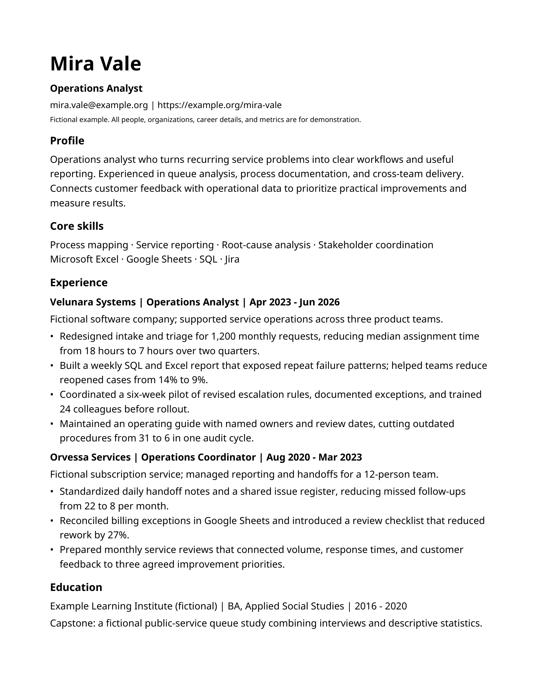
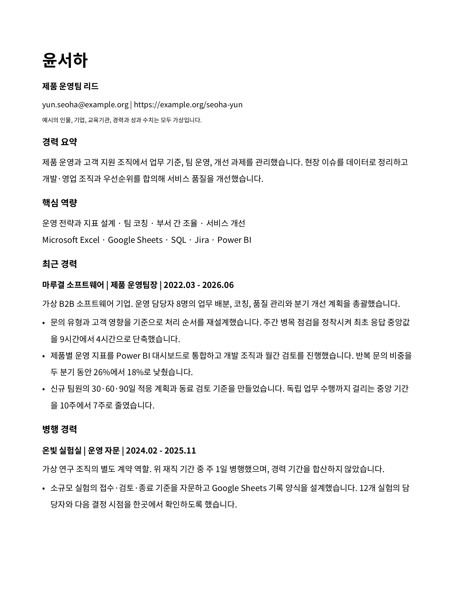

# 이력서 디자인 스킬

이력서의 사실과 제출 조건을 보존하면서 경력·역할·성과를 찾기 쉽게 배치하는 공개 Agent Skill입니다. 한국어와 영어가 섞인 문서, 경력이 긴 지원자, 회사 지정 Word 양식을 다룹니다.

**스킬 이름:** `resume-design` · **라이선스:** MIT · **자료 확인일:** 2026-11-08

## 무엇을 하는가

- 이름·연락처·경력·학력·성과의 정보 순서와 시각적 위계를 정합니다.
- 서체, 글자 크기, 여백, 문단 간격, 페이지 나눔을 일관되게 설계합니다.
- 회사 지정 양식의 필수 항목과 표 구조를 보존합니다.
- DOCX의 내용 유실·변경 추적·주석·숨김·배치 위험을 읽기 전용으로 점검합니다.
- 최종 DOCX·PDF의 모든 페이지, 텍스트 순서, 글꼴, 링크를 확인하는 절차를 제공합니다.

개발·AX·재무·영업·인사·운영 등 직무에 공통으로 적용합니다. 직무에 맞는 경력 선택과 성과 서술은 아래 내용 작성 스킬과 함께 사용합니다.

## 예제 미리보기

아래는 이 저장소에서 새로 만든 합성 예시입니다. 인물·회사·경력·수치는 실제 지원자의 자료가 아닙니다. 일반형 한 쪽과 경력자형 두 쪽은 구조를 보여 주는 예시이며 모든 지원서의 분량 기준이 아닙니다.

| 일반형 | 경력자형 |
| --- | --- |
| [DOCX](examples/standard-resume.docx) · [PDF](examples/standard-resume.pdf) | [DOCX](examples/experienced-manager-resume.docx) · [PDF](examples/experienced-manager-resume.pdf) |
|  |  |

경력자형의 둘째 쪽은 PDF에서 확인할 수 있습니다. 최신 렌더와 확인 범위는 [검증 기록](docs/validation.md)에 남깁니다.

## 사용

`skills/resume-design/`가 하나의 설치 가능한 패키지입니다. 전체 폴더를 사용하는 에이전트의 스킬 디렉터리에 넣거나, 해당 환경의 스킬 추가 기능으로 가져오세요. `SKILL.md`만 따로 복사하면 참조 문서와 도구가 빠집니다.

```text
$resume-design
회사 지정 양식과 경력 사실을 유지하면서 이력서의 글꼴, 여백,
정보 배치와 페이지 나눔을 정리해 주세요. 최종 DOCX와 PDF의
모든 쪽을 렌더하고, 텍스트 순서와 핵심 수치도 대조해 주세요.
```

스킬 형식은 [Agent Skills 사양](https://agentskills.io/specification)의 `SKILL.md`와 선택적 리소스 폴더 구조를 사용합니다. 환경별 설치 기능과 렌더 도구는 다를 수 있습니다.

## 세 가지 디자인 경로

| 경로 | 적용 상황 | 핵심 판단 |
| --- | --- | --- |
| 기본형 | 자유 형식 이력서 | 단일 열, 명확한 섹션, 일관된 서체·간격 |
| 경력자형 | 경력이 길거나 팀장·리더 지원 | 책임 범위·본인 기여·결과와 이전 관련 경력의 연결 |
| 지정 양식형 | 회사의 표·필수 항목·쪽수 요구가 있음 | 원본 구조를 유지하며 허용된 서식만 정리 |

학술 CV와 상세 경력기술서는 각 문서의 목적과 제출 규정을 따릅니다. 긴 경력을 무조건 한 쪽에 넣거나 필수 정보를 작은 글씨로 밀어 넣지 않습니다.

## 모범 사례와 근거

| 자료 | 반영한 설계 판단 |
| --- | --- |
| [Harvard MCS](https://careerservices.fas.harvard.edu/resources/create-a-strong-resume/) | 일관된 배열, 충분한 여백, 관련 경력의 명확한 순서 |
| [MIT CAPD](https://capd.mit.edu/resources/resumes/) | 직무 관련성에 따른 정보 선택, 절제된 강조, 긴 경력의 분량 예외 |
| [Greenhouse](https://support.greenhouse.io/hc/en-us/articles/200989175-Unsuccessful-resume-parse) | 다단·텍스트 상자·복잡한 표 등의 파싱 위험을 확인하고 실제 결과 검토 |
| [Microsoft Word](https://support.microsoft.com/en-us/accessibility/word/make-your-word-documents-accessible-to-people-with-disabilities) | 기본 제목·목록 스타일, 표의 의미 구조, 접근성 점검 |
| [W3C PDF3](https://www.w3.org/WAI/WCAG22/Techniques/pdf/PDF3) | 보기 좋은 외관과 논리적인 PDF 읽기 순서를 별도 검증 |

11개 1차 자료의 확인 범위와 한계는 [출처 장부](skills/resume-design/references/sources.md), 기존 스킬·템플릿의 비교는 [기존 사례 조사](docs/prior-art.md)를 참고하세요. 글자 크기와 여백의 구체적인 시작값은 이 프로젝트의 디자인 선택으로 구분했습니다.

## 도구 실행

### DOCX 사전 검사

Python 3.10 이상과 표준 라이브러리만 사용합니다. 입력 파일을 수정하거나 외부 서버에 업로드하지 않습니다.

```bash
python3 skills/resume-design/scripts/audit_docx.py final.docx \
  --baseline original.docx --required-text critical-text.txt
```

`critical-text.txt`에는 원문에서 반드시 유지할 문자열을 한 줄씩 넣습니다. 서식만 바꾸는 작업에 `--baseline`을 사용하세요. 내용 편집도 허용했다면 차이를 직접 검토해야 합니다.

종료 코드 `0`은 자동으로 발견한 차단 항목이 없음, `1`은 수동 해결이 필요한 항목 존재, `2`는 입력 오류입니다. 경고와 검사 한계를 JSON으로 제공합니다. 표나 꼬리말이 있다고 파일을 자동 탈락시키지 않습니다.

### 예제 다시 만들기

예제 생성에는 `python-docx`가 추가로 필요합니다. 필요한 글꼴을 설치한 환경에서 실행하세요. PDF 변환과 페이지 검수에는 별도의 Word·LibreOffice·Poppler 같은 도구를 사용합니다.

```bash
python3 -m pip install -r requirements-examples.txt
python3 skills/resume-design/scripts/build_examples.py --output-dir build/examples
python3 -m unittest discover -s tests -v
```

## 기존 ContextualWisdomLab 스킬과의 역할

| 저장소 | 책임 |
| --- | --- |
| [team-lead-resume-skills](https://github.com/ContextualWisdomLab/team-lead-resume-skills) | 팀장급 지원을 위한 경력 선택·요약·근거 연결 |
| [career-description-skills](https://github.com/ContextualWisdomLab/career-description-skills) | 상세 경력의 역할·행동·결과 정리 |
| [korean-writing-skills](https://github.com/ContextualWisdomLab/korean-writing-skills) | 한국어 문장·논리·표기와 의미 보존 |
| 이 저장소 | 정보 배치·타이포그래피·페이지 구성·파일 검수 |

## 검증 범위와 재사용

이 도구는 채용 성과, ATS 통과율, PDF/UA 또는 WCAG 전체 적합성을 판정하지 않습니다. 구조 검사와 텍스트 추출이 통과해도 최종 페이지와 실제 제출 환경을 확인해야 합니다. 검증 기록에는 수행한 검사와 미실시 항목을 따로 표시합니다.

자체 작성한 스킬·도구·합성 예제는 [MIT License](LICENSE)로 배포합니다. 외부 문서와 템플릿은 링크로 참고하며 각 원저작자의 권리를 따릅니다. 글꼴 파일은 포함하지 않습니다. 실제 지원자 자료를 공개 예시·이슈·평가 로그에 넣지 마세요.
